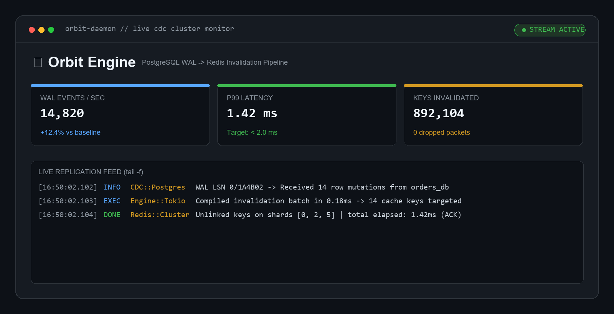

<div align="center">

# ⚡ Orbit
### Distributed Cache Invalidation in Real-Time

[](LICENSE)
[](https://github.com/joaofr-tech/readme-templates)
[](https://www.typescriptlang.org)
[](https://www.docker.com)
[](https://github.com/joaofr-tech/readme-templates/pulls)

<!-- 1 Frase de impacto: o que faz e por que importa -->
**Um middleware ultra-rápido que escuta eventos de banco via CDC e invalida chaves no Redis em <2ms.**

[Demo ao Vivo](https://github.com/joaofr-tech/readme-templates) · [Reportar Bug](https://github.com/joaofr-tech/readme-templates/issues) · [Documentação](https://github.com/joaofr-tech/readme-templates)

<br/>

<!-- HERO VISUAL: 1 imagem de impacto vale mais que 10 parágrafos -->


</div>

---

### 💡 Por que o Orbit?

Sistemas distribuídos sofrem com caches obsoletos após updates concorrentes. O Orbit resolve isso eliminando código manual de cache:

- **Zero Código Manual:** Detecta mutações diretamente pelo Write-Ahead Log (WAL) do Postgres.
- **Latência P99 < 2ms:** Processamento em memória via Rust core exposto para Node e Go.
- **Buffer Resiliente:** Se o Redis cair, mantém buffer local em RocksDB sem perda de mensagens.

---

### 🚀 Comece em 60 Segundos

```bash
# 1. Clone o repositório
git clone https://github.com/joaofr-tech/orbit.git && cd orbit

# 2. Suba o ambiente com Postgres e Redis
docker compose up -d

# 3. Inicie o worker
npm run dev
```

Pronto! Acesse `http://localhost:3000` para ver os eventos em tempo real.

---

### 🧰 Stack Tecnológica

| Camada | Tecnologia | Motivo da Escolha |
| :--- | :--- | :--- |
| **Engine CDC** | Rust / Tokio | Baixo consumo de memória e concorrência nativa |
| **API & Worker** | Node.js / TypeScript | Integração ágil e ecossistema flexível |
| **Storage & Cache** | Redis 7 + PostgreSQL 16 | Confiabilidade de dados e pub/sub de alta velocidade |

---

<details>
<summary>📂 <strong>Quer usar este template nos seus próprios projetos? (Clique para expandir)</strong></summary>

<br/>

Este repositório serve como um **design system de READMEs compactos** mantido por [João Francisco](https://github.com/joaofr-tech).

Você encontra os modelos brutos para copiar na pasta [`templates/`](templates/):
* 📄 [`templates/PRODUCT_HERO.md`](templates/PRODUCT_HERO.md) — O modelo acima pronto para preencher.
* 📄 [`templates/HACKER_MINIMALIST.md`](templates/HACKER_MINIMALIST.md) — Modelo direto para CLIs e infra.
* 📄 [`templates/BENTO_GRID.md`](templates/BENTO_GRID.md) — Modelo em grade com métricas e "Antes vs. Depois".

</details>

---

<div align="center">
  <sub>Criado por <strong><a href="https://github.com/joaofr-tech">João Francisco</a></strong> · Distribuído sob a licença MIT.</sub>
</div>
